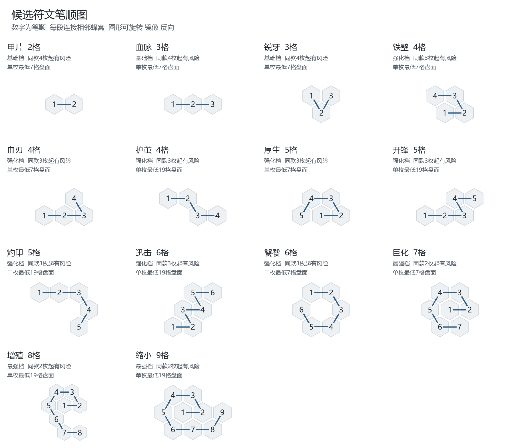

# 涌现召唤战斗与妖兽仓库整合策划案

版本 v0.2　日期 2026年10月14日　适用对象 策划 程序 美术与测试

本案将法阵成长、符文构筑、妖兽生成、实时物理群战、永久死亡、战损魔力回收与书页式仓库串成完整流程。玩家通过剧情和战胜 Boss 扩展法阵，在有限空间内决定强度、能力、数量和风险，再通过独立战斗场景验证构筑，并管理能够永久损失的妖兽。

本案中的规则分为三种状态。已确认规则用于约束后续设计；测试提案用于首轮制作与比较，可根据实战调整；待定事项必须在对应功能进入正式制作前补齐。文档中的攻击、护甲、生命、符文效果倍率、随机范围和部位生命方案均为测试提案。畸变概率与成功强化倍率尚未设定。

## 1 核心规则与制作范围

### 1.1 已确认规则

| 内容 | 规则 |
| --- | --- |
| 法阵成长 | 基础7格，三次升级分别增加12、18、24格，总数为7、19、37、61格；升级受剧情和战胜Boss状态控制 |
| 法阵与妖兽 | 法阵等级与妖兽等段分开；本次实际魔力投入影响妖兽基准强度，不允许额外支付魔力直接提段 |
| 符文与奇物消耗 | 符文占格形成构筑投入；奇物每个占用格消耗与符文格相同的魔力，保持原有奇物机制 |
| 生成强度 | 妖兽等段强相关地决定随机属性范围；符文次强相关地决定属性强化、属性分配和战斗特性 |
| 普通产出 | 单次普通召唤基础产出5只妖兽 |
| 结构符文 | 保留巨化、增殖、缩小机制，数量、体型和编队占用随规则变化 |
| 畸变门槛 | 最弱三枚基础符文同款4枚及以上；强化档同款3枚及以上；最强档同款2枚及以上，产生畸变可能 |
| 畸变收益 | 成功畸变极大强化触发风险的重复符文效果，并具有特殊外形；畸变也可能导致召唤失败 |
| 特殊畸变 | 两枚巨化进入超巨化分支，成功仅产出1只，占5个队位，基础属性极高且失败风险极高 |
| 特殊召唤 | 特定符文组合或空间模式能够定向召唤特殊类别，每次仅产出1只；配方可能要求特定奇物 |
| 战斗体验 | 独立3D战斗场景中的实时多单位对多单位交战，单场目标10至60秒 |
| 成长与死亡 | 妖兽召唤完成后不能继续永久变强；战斗死亡为永久死亡 |
| 魔力回收 | 仅本场胜利时，按己方战死妖兽原等段回收：一段0、二段1、三段2，依次递增；分身和缩小群体不回收 |
| 仓库框架 | 展开的书页形式，左半边为已有妖兽列表，右半边为当前所选妖兽的详细展示 |

### 1.2 本案的边界

本案不重新定义地图移动、完整剧情、Boss名单和事件奖励表。它规定这些系统需要向召唤与战斗提供的地点、解锁和结算条件。符文知识、场地元素、引导物等旧稿内容若继续采用，需要独立确认，不作为本次已确定机制写入。

首轮重点是验证构筑能否产生可辨认差异、群战是否在目标时间内结束、永久损失是否可理解，以及仓库是否能清楚管理不同体型和队位占用的个体。首轮不承诺全部候选符文、全部形态或最终美术已经完成。

### 1.3 术语

| 术语 | 定义 |
| --- | --- |
| 法阵等级 | 剧情开放的盘面阶段，决定空间容量与可达构筑上限 |
| 妖兽等段 | 妖兽生成时确定的强度档次，影响基础随机属性范围，生成后固定 |
| 符文强度档 | 基础档、强化档、最强档，决定重复畸变门槛，与妖兽等段相互独立 |
| 队位 | 编队容量单位，区别于妖兽只数 |
| 普通召唤批次 | 一次确认召唤形成的全部产出与投入记录 |
| 畸变体 | 发生畸变且成功生成的妖兽，持有强化效果与对应外形表现 |
| 分身 | 妖兽在战斗中生成的临时单位，不是新的永久库存个体 |

## 2 玩家流程

玩家完成剧情或战胜指定Boss，获得法阵扩圈权限。进入召唤界面后，先在当前盘面绘制符文、放置奇物，查看实际投入、预计妖兽等段、能力倾向、产出数量与队位占用。当重复符文达到阈值时，界面新增畸变风险说明。

确认召唤后，按本次构筑完成扣费和结果确定，再进行召唤演出。结果可能包含普通成功、畸变成功或失败；超巨化与特殊配方可能将整次产出改为单只。已确定结果不会因为跳过演出、打开仓库或重载而重新抽取。

玩家在结果页查看产出并安置，随后从书页仓库选择出战单位。进入独立战斗场景完成布阵，开始实时交战。结算显示胜负、存活个体、永久死亡个体、符合条件的魔力回收及地点奖励，再返回原场景。

系统至少应保留召唤结果、未安置个体、编队、死亡事实和已完成结算。反复打开页面、重复点击或恢复进度不能产生重复妖兽或重复回收。

## 3 法阵成长与魔力投入

### 3.1 四个盘面阶段

| 阶段 | 六边形半径 | 本次新增格数 | 可用总格数 | 预期构筑表现 |
| --- | --- | ---: | ---: | --- |
| 基础 | 1 | 7 | 7 | 少量基础强化，直观比较攻击与生存方向 |
| 第一次升级 | 2 | 12 | 19 | 属性与特性组合，开始出现重复畸变风险 |
| 第二次升级 | 3 | 18 | 37 | 多种能力与特殊构筑，能够容纳当前两枚巨化图形 |
| 第三次升级 | 4 | 24 | 61 | 复杂布局、高投入构筑与特殊召唤配方 |

具体剧情节点、对应Boss与解锁奖励待配表。升级只开放额外格子，不自动改变已经生成的妖兽，也不保证每次召唤产出最高等段。

### 3.2 投入与扣费

符文与奇物不能重叠占格。同一有效格子只计算一次对应消耗。首轮测试统一采用每格1魔力，因此本次消耗为符文占格数与奇物占格数之和；每格同价是已确认方向，具体单价仍属于数值配置。

预计等段由本次构筑投入形成，不能额外点击支付魔力购买提段。法阵阶段限制可达投入和等段上限。等段门槛、同段内投入如何影响基础范围、奇物投入在提段计算中的权重待定。

原型的停用符文保留占格。停用是否继续收费、是否计入等段、是否计入畸变重复，必须在正式公式中分别规定；本案不把旧原型行为直接视为新规则已确认。

绘制、撤回、删除、保存和重开界面不得重复扣费。召唤确认时必须同时检查余额、盘面合法性、草稿状态和结果接收条件。召唤失败的扣费、部分失败的分摊及返还规则待定。

### 3.3 空间约束

图形能否容纳由真实占格决定，不能仅比较格数总和。已验证的当前候选图形中，7格盘面能放入血脉与两枚甲片，也能放入锐牙与两枚甲片；血脉与锐牙虽然共6格，仍无法在7格盘面无重叠放入。

候选巨化占完整7格簇。单枚可以放入基础盘，但两枚无重叠摆放需要37格盘面。符文能够容纳不等于剧情已经开放该符文。

## 4 妖兽等段与生成边界

### 4.1 固定个体

妖兽由主形态、战斗原型、等段、基础属性、符文效果、奇物效果、结构变化与畸变结果组成。首轮主形态沿用人形、兽形、蛇形作为候选；每类先采用可移动、可攻击的标准结构。

等段与永久属性在召唤完成时固定，不通过战斗经验、反复出战或仓库操作提高。战斗中的护盾、治疗和临时加成依对应能力结算。恢复受损状态是否在战后自动进行，见第8节待定项。

同一妖兽的外观和能力保持稳定。查看详情、进入新战斗或改名不能改变形态、重新抽属性或生成新的个体。

### 4.2 基础强度提案

首轮按四段普通模板试算。以下为各段代表基准，未确定魔力门槛，也不表示跨过一格投入就立即获得全部段间增幅。

| 等段 | 总生命 | 攻击 | 护甲 | 普通攻击实际周期 | 胜利时战死回收 |
| --- | ---: | ---: | ---: | ---: | ---: |
| 一段 | 200 | 30 | 5 | 1.5秒 | 0魔力 |
| 二段 | 280 | 42 | 7 | 1.5秒 | 1魔力 |
| 三段 | 392 | 59 | 10 | 1.5秒 | 2魔力 |
| 四段 | 549 | 82 | 14 | 1.5秒 | 3魔力 |

生命与攻击约按每段1.4倍增长，护甲保持接近同比例。普通攻击周期、移速和射程不自动随等段提高，由原型和符文塑造。生命与攻击同时提高会放大综合战斗价值，相邻段实际能交换多少低段单位，必须通过群战验证。

基础生命与攻击随机范围先测试基准上下约8%。护甲主要由原型确定。同段投入决定范围内的位置或范围中心的方案待定；应避免随机差异盖过符文差异，以及提段边界出现过大的突增。

## 5 符文体系与候选表

### 5.1 分类与叠加

属性类符文提高攻、防、血等基础属性，或在属性之间进行重分配。特性类符文改变伤害性质、护盾、恢复或攻击节奏。巨化、增殖、缩小属于改变结构和组织方式的特殊强化。

最弱三枚基础符文的图形方向已确认：两格直连强化护甲，三格直连强化生命，三格V形强化攻击。下表名称、数值和4格以上图形均为测试候选。当前暂将4至6格候选归为强化档，巨化、增殖、缩小归为最强档；正式归档依据效果强度确定，不永久绑定格数。

首轮普通效果试算中，同属性百分比增量相加，再计算结构倍率；生命强化同时作用于总生命和部位耐久。普通叠加上限与畸变是否突破上限待定。

### 5.2 属性类候选

| 符文 | 格数 | 强度档 | 普通效果测试值 | 同款畸变门槛 |
| --- | ---: | --- | --- | ---: |
| 甲片 | 2 | 基础档 | 护甲增加40% | 4枚 |
| 血脉 | 3 | 基础档 | 总生命与部位耐久增加15% | 4枚 |
| 锐牙 | 3 | 基础档 | 攻击增加12% | 4枚 |
| 铁壁 | 4 | 强化档 | 护甲增加100% | 3枚 |
| 血刃 | 4 | 强化档 | 攻击增加35%，总生命与部位耐久降低15% | 3枚 |
| 厚生 | 5 | 强化档 | 总生命与部位耐久增加35% | 3枚 |
| 开锋 | 5 | 强化档 | 攻击增加28% | 3枚 |

护甲增加40%是护甲数值增长，并非获得40%减伤。一段护甲5使用单枚甲片后为7。大符文需要与同成本的小符文组合比较空间效率、收益与畸变门槛，保留不同用途。

### 5.3 特性类候选

| 符文 | 格数 | 强度档 | 普通效果测试值 | 同款畸变门槛 |
| --- | ---: | --- | --- | ---: |
| 护茧 | 4 | 强化档 | 入场获得最大生命20%的共享护盾，持续10秒，每场一次 | 3枚 |
| 灼印 | 5 | 强化档 | 普攻有效命中施加3秒灼烧，每秒造成攻击的12%；同目标保留最强并刷新，扣总生命 | 3枚 |
| 迅击 | 6 | 强化档 | 实际攻击周期乘0.80，相当于攻速增加25%；最低周期先测试0.5秒 | 3枚 |
| 饕餮 | 6 | 强化档 | 击杀非分身敌人恢复最大生命15%；每场最多3次，不修复已经破坏的部位 | 3枚 |

护盾按整只妖兽共享，不能每个部位各复制一层。灼烧先测试绕过护甲、仍受护盾吸收。回血按一次有效击杀结算，不能因同一目标多个部位破坏重复触发。攻击周期取实际两次攻击之间的时间，不能只调整冷却字段而忽略动作长度。

### 5.4 结构类候选

| 符文 | 格数候选 | 强度档 | 已确认表现 | 普通效果数值提案 |
| --- | ---: | --- | --- | --- |
| 巨化 | 7 | 最强档 | 单次3只，每只占2队位，体型与攻防血提高 | 生命乘1.80，攻击乘1.50，护甲乘1.50 |
| 增殖 | 8 | 最强档 | 本体攻防血降低，入场产生分身；分身不可回收 | 仍产出5只本体，本体攻防血乘0.80；各产生1个具有本体50%属性、仅继承普攻的分身 |
| 缩小 | 9 | 最强档 | 生成极小弱单位，每5只占1正常队位；不可回收 | 仍产出5只，生命乘0.20，攻击乘0.30，护甲乘0.20 |

结构候选的强度倍率、分身继承比例、缩小产出数量与不完整群组占位属于测试提案或待定事项。结构符文叠放、互斥或组合规则暂保留设计，在实际组合产生风险时判断。

### 5.5 图形与空间

所有候选遵守连续相邻、单笔不重复格、平移和允许旋转镜像反向等价的绘制要求。笔顺图见附录A，图形坐标见附录B。图形占格与名称、效果分别记录，方便后续替换效果而保留识别校验。

## 6 畸变与特殊召唤

### 6.1 三档畸变门槛

| 符文强度档 | 同款数量 | 结果 |
| --- | ---: | --- |
| 基础档 | 1至3枚 | 尚未达到该符文的畸变门槛 |
| 基础档 | 4枚及以上 | 该符文开始贡献畸变风险 |
| 强化档 | 1至2枚 | 尚未达到该符文的畸变门槛 |
| 强化档 | 3枚及以上 | 该符文开始贡献畸变风险 |
| 最强档 | 1枚 | 尚未达到该符文的畸变门槛 |
| 最强档 | 2枚及以上 | 该符文开始贡献畸变风险 |

重复按同款符文分别统计，不把所有强化同一属性的不同符文直接合并计数。每种符文独立记录风险贡献；多个来源怎样合成最终概率，以及同时触发时强化哪些来源，待定。

四枚最便宜的甲片也需8格，因此基础7格法阵无法通过当前符文触发畸变。新门槛通过空间成长自然延后风险，不再需要仅为这三枚基础符文增加额外剧情风险开关。中后期具体出现时间仍由升级与符文获取安排控制。

### 6.2 风险与收益

普通召唤按妖兽分别判断畸变，可形成普通成功、畸变成功或失败结果。是否采用完全独立抽取、概率如何随重复增加、失败个体如何影响批次剩余产出，待定。

成功畸变极大强化触发风险的重复符文效果。甲片畸变突出护甲，血脉突出生命与耐久，锐牙突出攻击；特性畸变突出对应护盾、持续伤害、攻击节奏或恢复行为。外观应表达被强化的方向，让玩家从形象与能力说明识别该个体。

畸变概率、失败条件、成功率与强化倍率尚未设定，不能从普通叠加倍率推导为已经定案。血刃等带代价符文的负面效果是否同时放大，畸变是否突破普通能力上限，均需另行确定。

### 6.3 超巨化

两枚巨化达到最强档门槛时，进入超巨化特殊分支。成功产出1只、占5队位、基础数值极高，存在极高失败可能。确认前必须显示数量、队位与风险的变化。

这一分支改变整批产出，不应在普通三只巨化个体分别抽取后再临时改变总数量。是否提供普通巨化与超巨化的主动选择，以及超巨化详细数值和失败扣费，待定。

### 6.4 特殊配方

特殊召唤通过匹配特定符文组合或空间模式定向生成特殊类别，每次仅产出1只，可能同时要求特定奇物。配方需说明组成、数量、布局关系、奇物要求、投入条件和产出类别。

配方匹配优先关系、额外笔画是否允许、配方所需重复是否附带普通畸变，以及特殊配方与超强化畸变冲突的处理，待配方制作时规定。有效配方不能被未说明的普通随机生成覆盖。

### 6.5 召唤界面信息

界面常驻当前法阵阶段、魔力余额、占格投入、预计等段、普通能力倾向、产出数量与预计队位占用。当任何符文达到阈值时，才出现畸变区域，显示风险来源、每个产出个体的风险口径、失败可能、成功强化方向及特殊数量变化。

魔力不足、图形冲突、未完成草稿或接收条件不足分别显示明确原因。未确定的概率在策划测试中标为未定，不以虚构百分比作为正式承诺。

## 7 实时群战与部位数值提案

### 7.1 战斗节奏

| 遭遇类型 | 时长测试目标 |
| --- | --- |
| 简单或明显优势遭遇 | 10至20秒 |
| 实力接近的普通群战 | 20至40秒 |
| 强敌与Boss战 | 40至60秒 |

时长从正式开战到结算计算。普通场地首次接敌先以2至5秒为观察目标。单独记录首次永久死亡时间，检查单位是否有机会完成动作、能力触发和可辨认的退场表现。

胜负由双方有效单位状态决定。空阵容、双方同时死亡、无法接敌和持续无伤害等边界需要明确结算。超过目标上限时应识别僵局并提供结束入口，不因超时自动获得胜利，也不直接杀死仍存活单位。具体僵局、撤退与失败口径待定。

### 7.2 总生命与部位耐久

建议首轮在现有独立部位生命基础上，增加统一总生命预算。命中造成的伤害同时扣总生命与受击部位耐久，总生命只扣一次。总生命归零或形态定义的致命核心破坏可导致死亡。该双层方案尚未确认，需与继续沿用纯部位生命方案比较后选择。

| 一段普通单位参照 | 测试值或目标 |
| --- | --- |
| 总生命 | 200 |
| 单一主要躯干耐久 | 200，约承受6至9次有效普通命中 |
| 单一头部耐久 | 150，约承受4至6次有效普通命中 |
| 普通肢体耐久 | 60，约承受2至3次有效普通命中 |
| 普通攻击与护甲 | 攻击30，护甲5 |
| 实际攻击周期 | 1.5秒，初测范围1.3至1.8秒 |

多头、多躯干和多节结构需要按形态分配关键部位预算，不给每个新增核心完整复制同一份额外生存能力。蛇形应明确致命核心和辅助节段，避免任何节段断开都无条件导致整只死亡。

### 7.3 伤害与命中

建议以妖兽攻击属性作为伤害基准，动作定义其倍率，物理接触只在有限范围修正有效命中伤害。普通物理修正先测试0.8至1.2倍。巨化的攻击强化与质量变化需要避免重复无限放大伤害。

护甲暂沿用平减，普通减伤目标先测试10%至25%。有效攻击的护甲后伤害取原始伤害的20%与原始伤害减部位护甲中的较大值，以减少高护甲造成的无伤僵局。未命中或非攻击碰撞不获得最低伤害。护甲结算后再扣护盾，余量扣生命。

同一次攻击对同一敌人的多部位接触建议共用伤害预算，再分配至受击部位。范围攻击对不同敌人的预算单独规定。一次部位破坏、击杀和死亡各只结算一次对应能力，避免多部位导致重复回血、发奖或回收。

### 7.4 基准试算

在集中攻击普通躯干、有效命中率假设65%的条件下，一段伤害为30减5等于25，总生命200约需要8次有效命中。参照时间为200×1.5÷（0.65×25），约18.5秒。四段同段对抗按本案模板均约18至19秒。

| 固定一段的构筑 | 生命 | 攻击 | 护甲 | 普攻击杀参照 | 受普攻存活参照 |
| --- | ---: | ---: | ---: | ---: | ---: |
| 无符文参照 | 200 | 30 | 5 | 18.5秒 | 18.5秒 |
| 血脉与甲片2枚 | 230 | 30 | 9 | 18.5秒 | 25.3秒 |
| 锐牙与甲片2枚 | 200 | 33.6 | 9 | 16.1秒 | 22.0秒 |
| 血刃单枚 | 170 | 40.5 | 5 | 13.0秒 | 15.7秒 |
| 迅击单枚 | 200 | 30 | 5 | 14.8秒 | 18.5秒 |

以上为解析参照，固定等段以隔离符文效果，不计投入提段、护盾、灼烧、回血、分身、倒地、集火和致命部位。不能把这些时间直接视为实际群战时长。

## 8 永久死亡与资源回收

### 8.1 回收条件

回收同时要求本场获胜、单位属于己方真实永久妖兽、该单位本场已经战死，且不属于缩小群体。回收额按原等段减1计算，一段为0。存活单位、分身与缩小群体不回收。

战败或僵局不按此胜利回收规则发放魔力，已发生的永久死亡仍保留。妖兽死亡后从可用名册和编队移除，回收不能使其复活。畸变与体型强化不自动提高原等段或回收额。

### 8.2 资源循环评估

| 普通5只产出示例 | 总投入假设 | 每只账面分摊 | 每只死亡回收 |
| --- | ---: | ---: | ---: |
| 一段对应满基础盘 | 7魔力 | 1.4魔力 | 0魔力 |
| 二段对应满19格盘 | 19魔力 | 3.8魔力 | 1魔力 |
| 三段对应满37格盘 | 37魔力 | 7.4魔力 | 2魔力 |
| 四段对应满61格盘 | 61魔力 | 12.2魔力 | 3魔力 |

这是一组满盘成本示例，未确定的提段门槛不能据此自动认定。单只分摊用于账面比较，不代表可以按该价格购买单只妖兽。候选下二至四段回收大约为分摊投入的四分之一，适合作为有限战损补偿。

正式门槛需检查一批可回收单位的总回收额低于该批实际成本，避免刻意牺牲获利。分身和缩小群体的不可回收规则直接排除数量扩张刷回收。

事件或战利品等独立魔力来源仍需配置。初始资源、一段无回收和早期战败必须一起测试，保证队伍损失后仍有可继续获取资源和重组队伍的路径。

### 8.3 幸存者恢复

首轮建议幸存妖兽战后恢复生命与可修复部位，死亡保持永久；该恢复规则尚未确认。若采用持续伤残，需另行规定修复时间、费用、不可修复部位与出战限制，避免与永久减员同时形成未说明的双重损耗。

## 9 书页式妖兽仓库

### 9.1 总体布局

仓库采用展开书本的左右两页。左页负责检索、比较和选择，右页负责所选妖兽的完整展示及操作。玩家在同一界面完成找妖兽、看能力和调整编队。

页面上方常驻持有数量、出战只数、已占队位与队位上限。左右页分别滚动，标题、队位摘要和主要操作保持可见。书脊和纸张装饰不遮挡内容，不让翻页动画改变选中个体或执行业务操作。

### 9.2 左页内容

| 区域 | 内容需求 |
| --- | --- |
| 页眉 | 妖兽名册、持有数量、出战只数与队位摘要 |
| 基础筛选 | 全部、未编队、已编队 |
| 进一步筛选 | 形态、等段、畸变体等，按内容规模增加 |
| 搜索排序 | 名称搜索；等段、召唤时间、名称排序，默认新获得靠前 |
| 列表记录 | 小形象、名字、形态、等段、编队占用、状态、少量主要特性 |
| 页脚 | 筛选结果数量与分页或滚动位置 |

普通个体以一只一条记录为主。选中标记与已编队标记分别表现。列表不塞入完整属性与全部能力；能力摘要超出时显示还有若干项，右页完整展开。

缩小群体建议按同次召唤形成可展开群组，左页显示存活成员数与实际占位，右页可查看成员。成员仍是可辨认的个体。群组不足5只、跨批合并及拆分后的队位计算待定。

### 9.3 右页内容

| 区域 | 内容需求 |
| --- | --- |
| 身份标题 | 名称、改名入口、形态、等段、畸变类型、编队状态 |
| 形象 | 该个体的真实外观与部件，突出巨化、缩小和畸变；提供尺度参照 |
| 核心属性 | 总生命、攻击、护甲、实际攻击间隔、移速，按原型补充射程 |
| 部位信息 | 头部、核心、肢体耐久与破坏状态，可折叠；与总生命分开 |
| 能力 | 属性强化、战斗特性与结构变化，说明真实触发、持续、次数和上限 |
| 畸变说明 | 来源重复符文、被放大对象、最终效果、外观与结构变化 |
| 召唤来源 | 地点、魔力投入、来源符文、奇物、时间，仅作为已生成记录 |
| 操作 | 加入编队或撤回，加入后的队位预览，失败原因 |

默认显示最终属性，展开后显示基础、符文、奇物和畸变的来源贡献。形象预览后续可支持旋转、缩放与恢复视角。预览必须反映该个体，不能用通用示意图冒充真实畸变资产。

巨化、超巨化显示个体队位占用；缩小显示群组数量、实际队位以及单只属性，不能把单只数值写成群组总数值。增殖显示本体与分身的关系、分身属性和不可回收说明。

### 9.4 编队与死亡提示

操作区显示加入前后占位，例如4队位增加至6队位。队位不足时说明差额，并提供查看已编队单位的入口。队位上限尚未定案，当前原型6只限制不能直接等同新系统的6队位。

选中个体可以显示胜利时战死回收数额。该内容属于条件说明，不提供主动兑换或分解按钮。存活名册不保留可再次出战的死亡个体；阵亡记录可作为后续独立书签页。

妖兽生成后不能继续永久成长，首版主要操作为查看、改名和编队。经验、升级、强化与交易入口不进入本轮需求。

### 9.5 状态与交互

| 状态 | 表现 |
| --- | --- |
| 仓库为空 | 左页为空名册，右页提供简短召唤提示 |
| 筛选无结果 | 保留条件，提供清除筛选 |
| 队位不足 | 保持当前所选，显示不足数量 |
| 加入或撤回成功 | 同步列表、右页与队位摘要，保持选择 |
| 保存失败 | 保留操作前状态，提示失败，不显示成功 |
| 交战中 | 可查看详情，编队操作禁用并显示原因 |
| 所选个体阵亡 | 更新阵亡状态，结算后从可用名册移除 |
| 关闭能力或部位说明 | 返回同一个体和阅读位置，不推进剧情 |

切换列表记录不需要额外详情弹窗。初次打开可默认选中第一条；返回仓库优先恢复上次选择，已失效时再选择有效记录。分页、排序和列表增减后维持合理阅读位置，不能错误指向其他同名个体。

## 10 原型现状与规则迁移

| 内容 | 当前工程事实 | 本案目标 |
| --- | --- | --- |
| 法阵 | 原生规则固定61格，7符文与3奇物 | 7至61格成长，重新设计符文与风险 |
| 召唤产出 | 原生原型每次3只随机占位怪物 | 普通5只，结构与特殊分支改变数量 |
| 奇物费用 | 当前原型不按奇物格扣费 | 与符文格同价收费 |
| 妖兽数值 | 随机测试属性，多数符文只显示标签 | 等段范围、真实强化与能力、稳定实例 |
| 编队 | 当前以6只限制 | 按队位占用，区分普通与结构单位 |
| 战斗 | 主工程已有索敌、攻击、部位伤害；UI原型跳过后结算 | 独立场景中的真实群战及完整回执 |
| 仓库 | 列表与单独详情弹窗 | 书页双栏，选中后右页直接展示 |
| 死亡回收 | 当前UI原型未实现 | 永久死亡与胜利后的己方战损回收 |

主工程实际默认伤害资源将挥击最低原始伤害设为30、伤害上限设为10000，与脚本类默认值不同。现有一次挥击可以对多个部位分别结算，而冲击波按敌方个体记录命中。接入新攻击预算时应一起核对，不能只修改卡片数值。

本案保存为新的整合策划，不覆盖旧策划或将提案冒充已经接入。程序可以自主选择实现方式，但需要满足稳定个体、正确占位、死亡唯一、回收去重和失败结果一致的验收要求。

## 11 制作阶段与验收

### 11.1 制作顺序

| 阶段 | 重点 | 可验收结果 |
| --- | --- | --- |
| A 基础规则 | 四盘面、基础三符文、奇物收费、投入预览、普通5只 | 合法构筑正确扣费，个体固定，无重复产出 |
| B 最小战斗 | 标准结构、基准攻防血、真实3D交战、胜负与永久死亡 | 普通阵容能接敌、攻击和结束，死亡不可再次出战 |
| C 仓库与回收 | 书页双栏、队位、改名、胜利战损回收 | 数量与占位清楚，回收对象正确，失败不错误发放 |
| D 强化构筑 | 部分4至6格符文、畸变风险与结果、巨化 | 同预算构筑产生差异，风险与实际强化来源一致 |
| E 特殊内容 | 超巨化、增殖、缩小、特殊配方与对应外形 | 数量、队位、继承和不可回收规则正确 |

具体工期由实作评估，旧三至四日基础验证计划不自动覆盖全部新增内容。成本上升时先缩外观变体、候选符文数量、可视化细节与配方数量，保留扣费、真实胜负、永久死亡、条件回收和仓库基础操作。

### 11.2 验收清单

| 验证项 | 通过标准 |
| --- | --- |
| 法阵升级 | 7、19、37、61格正确；扩圈条件正确；重开不回退解锁或额外收费 |
| 输入与占格 | 三基础图形可绘制识别；允许变换无混淆；符文与奇物不重叠 |
| 扣费 | 符文与奇物同价，撤回与重开不重复扣费，余额不足不生成 |
| 普通产出 | 5只稳定个体；跳过、重开及恢复结果不改变属性或复制个体 |
| 畸变边界 | 基础3枚未触发、4枚触发；强化2枚未触发、3枚触发；最强1枚未触发、2枚触发 |
| 风险UI | 未达阈值不出现；达到后显示具体来源与已确定概率；不虚构待定概率 |
| 畸变收益 | 成功强化触发符文的方向；外形与能力说明对应；失败与部分结果按定案结算 |
| 超巨化 | 两巨化正确进入分支，成功1只、占5队位，确认前可见变化 |
| 特殊配方 | 组成、布局与奇物条件正确，成功定向1只，不被普通结果覆盖 |
| 实时战斗 | 接敌、换目标、命中、部位破坏与退场正确；普通战斗多数处于目标范围 |
| 永久死亡 | 死亡个体从可用名册和编队移除，恢复进度不复活或重发死亡事件 |
| 回收 | 只给胜利时己方战死真个体；一段0，二段1，依次增加；分身与缩小为0；重复结算不增加 |
| 队位 | 巨化2、超巨化5、缩小五只1；上限、群组规则与UI一致 |
| 仓库 | 左选右显、筛选、改名、出入队、空状态、保存失败、长名称和多特性可用 |

每轮记录地点、实际投入、法阵阶段、符文组合、等段、产出与畸变结果；战斗记录阵容、队位、首次接敌、首次死亡、总时长、胜负、永久损失和回收。先做同段5对5与相邻段比较，再测试巨化、分身和缩小群体。

## 12 待定事项

| 编号 | 待定内容 | 应在何时确定 |
| --- | --- | --- |
| D01 | 三次扩圈的剧情与Boss节点，候选符文获取顺序 | 剧情与关卡接入前 |
| D02 | 妖兽等段门槛、段内投入曲线、奇物及停用笔画的提段权重 | 生成与扣费定案前 |
| D03 | 采用总生命加部位耐久，或继续纯部位生命；各形态致命核心 | 正式伤害与死亡接入前 |
| D04 | 普通属性随机范围、物理伤害修正、护甲保底与多部位预算 | 第一轮实战后 |
| D05 | 重复风险贡献、概率合成、独立判断方式、成功率与失败扣费 | 畸变功能制作前 |
| D06 | 畸变放大倍率、普通上限突破、负面效果、多源强化及叠加 | 畸变数值测试前 |
| D07 | 结构符文组合、分身继承与行为、缩小数量及残余群组占位 | 对应特殊单位接入前 |
| D08 | 超巨化切换选择、完整数值、极高失败风险的实际概率 | 超巨化配表前 |
| D09 | 特殊配方模式、匹配优先级、额外笔画与畸变冲突 | 配方制作前 |
| D10 | 队位上限、仓库容量、幸存者恢复及持续伤残 | 编队与仓库正式接入前 |
| D11 | 初始资源、奖励来源、失败后的重组路径、僵局与撤退 | 完整试玩前 |
| D12 | 畸变外形、真实预览资产、部位点选与阵亡记录范围 | 美术与详情深化前 |

## 附录A 候选符文笔顺图

数字表示笔顺，线段连接相邻蜂窝；允许旋转、镜像与反向。图样属于本轮候选，正式替换时需重新校验同形冲突和空间容纳。

## 附录B 图形坐标与验证

采用六边形轴坐标，每行依序为单笔绘制路径。坐标只定义图形与相对摆放，不规定程序结构。

| 符文 | 依序坐标 | 单枚最低盘面 |
| --- | --- | --- |
| 甲片 | (0,0) (1,0) | 7格 |
| 血脉 | (-1,0) (0,0) (1,0) | 7格 |
| 锐牙 | (0,-1) (0,0) (1,-1) | 7格 |
| 铁壁 | (0,0) (1,0) (1,-1) (0,-1) | 7格 |
| 血刃 | (0,0) (1,0) (2,0) (2,-1) | 7格 |
| 护茧 | (0,0) (1,0) (1,1) (2,1) | 19格 |
| 厚生 | (0,0) (1,0) (1,-1) (0,-1) (-1,0) | 7格 |
| 开锋 | (0,0) (1,0) (2,0) (2,-1) (3,-1) | 19格 |
| 灼印 | (0,0) (1,0) (2,0) (2,1) (1,2) | 19格 |
| 迅击 | (0,0) (1,0) (1,-1) (2,-1) (2,-2) (3,-2) | 19格 |
| 饕餮 | (0,0) (1,0) (1,1) (0,2) (-1,2) (-1,1) | 7格 |
| 巨化 | (0,0) (1,0) (1,-1) (0,-1) (-1,0) (-1,1) (0,1) | 7格 |
| 增殖 | (0,0) (1,0) (1,-1) (0,-1) (-1,0) (-1,1) (-1,2) (0,2) | 19格 |
| 缩小 | (0,0) (1,0) (1,-1) (0,-1) (-1,0) (-1,1) (0,1) (1,1) (2,0) | 19格 |

候选图形已检查格数、相邻关系、重复格、有序识别与无序占格在旋转镜像下的冲突。14枚各24种方向与笔顺，共336个变体，未发现候选之间同形冲突。这是候选图形检查，不代表全部规则已经接入Godot运行。

## 附录C 资料与实现入口

| 资料 | 用途 |
| --- | --- |
| 模拟召唤中的符文召唤阵玩法策划案 | 原有61格、连续绘制、符文与奇物占格参考 |
| UI跳转原型中的已确认需求与制作边界 | 当前原型能力、占位战斗与测试参数 |
| UI跳转原型中的召唤和仓库接管导引 | 当前界面、实例、安置与存档交界 |
| it-is-time中的DamageRules与DefaultDamageRules | 当前原始伤害、护甲与资源覆盖 |
| it-is-time中的PhysicalBodyParts与CharacterDamageController3D | 当前部位生命、破坏与角色停用 |
| it-is-time中的NPCStateMachine3D与SampleWeapon3D | 索敌、攻击及多部位命中登记 |
| 涌现游戏系统框架首版原型v0.1 | 旧整合提案，用于核对差异，不替代本轮确认 |

本案不覆盖其他模块已经确认的内容。整合时按本案已确认规则执行，将测试提案通过验证后转为定案，并同步更新待定事项与对应文档。
