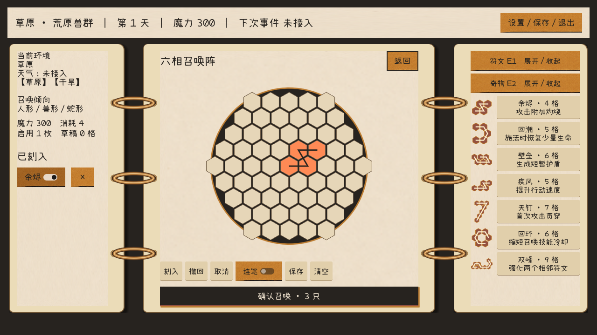
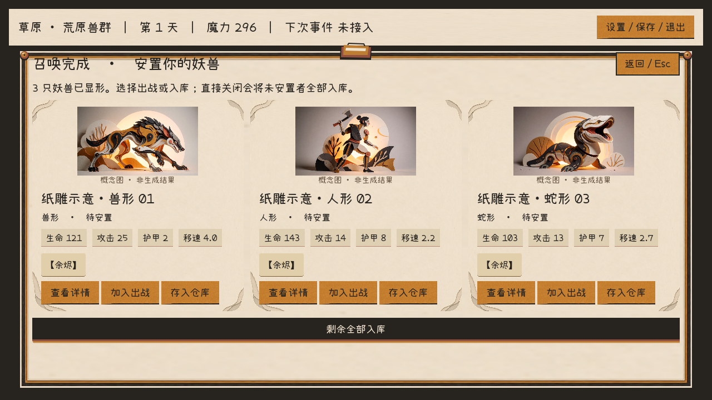
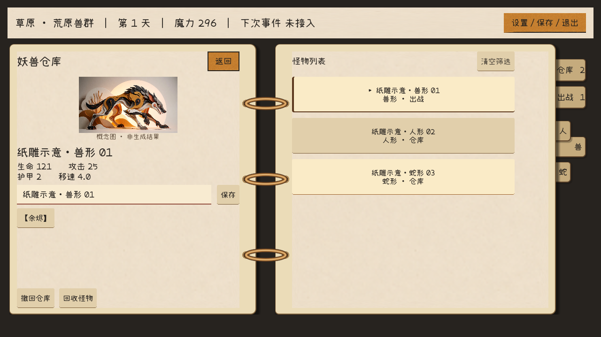

# 纸雕 UI 美术指导与素材格式

当前 UI 采用与用户怪物素材一致的层叠剪纸语言：骨白底纸、炭黑结构、赭黄操作片、少量锈铜。保留 A 方案的画板滑入和移画动作，减少水粉毛刷与木纹。本文供 UI、美术和接管成员替换独立分件；正式色板和最终资产仍待确认。

## 基础信息与范围

资源类型 UI，资源组 UI_PAPER_RELIEF，优先级 A；交付日期尚未指定。适用独立 UI 原型0.5，不修改正式工程、网页召唤、地图组或公共美术讨论稿。怪物外形、分类与生产拆件另由对应负责人维护，本次不把原图中的“多足狼”“沙虫”自动升级为已经实现的召唤配方或战斗能力。

原始依据是用户提供的 `D:/Downloads/1009素材.rar` 与 `D:/Downloads/10019美术素材.rar`，文件名照录。分别解包82与137张PNG，共219张；实际风格判断采用代表图抽查，不等于219张全部已完成质量验收。原RAR未修改。全部审阅副本在工程ReferenceReview/Raw，已忽略Git并隔断Godot导入；运行只引用选用的3张概念原图。

## 参考图应学习什么

| 参考来源 | 观察到的视觉特征 | 在 UI 中的转译 |
|---|---|---|
| 1009／多足狼／1 (1).png | 黑白剪纸躯体、赭黄和铜色叠层、圆形铆钉 | 炭黑框、骨白底、少量铜钉；不把肢体图案铺进正文 |
| 1009／巨鼠／2 (4).png | 大块轮廓、少量镂空、温暖舞台 | 小图标保留外轮廓和两三块色面，不堆微细节 |
| 10019／蜘蛛／ComfyUI_01078_.png | 放射纸片结构、明确黑白对比 | 用于形状和层级参考，不给每个按钮加蛛网 |
| 10019／蜘蛛森林／ComfyUI_01080_.png | 前后纸层、克制绿灰、暖背光 | 深度放在窗口外围；正文仍平整，不铺强光 |
| 10019／强盗／1 (5).png、沙虫／1 (3).png | 人形与蛇形也使用相同纸雕材质 | 三类形象卡共用同一边框与信息层级 |

三张实际插图副本在 `Assets/UI/PaperRelief/ExampleArt`，原像素与源图SHA256一致，均1344×768且抽样透明值为255。它们是带完整场景的概念插图，不能直接作为透明战斗角色贴图。展示时完整等比适配，不拉伸、重绘、强行裁掉肢体或假称已拆件。

抽查两张“强盗拆件”“沙虫拆件”检测到真实透明通道，不能因为预览发黑就断言有黑底。文件名同样不能证明可直接生产：还需检查半透明边缘、色边、每个部件是否独立文件、遮挡补绘、根部搭接与装配基准。本轮没有批量抠图或修改怪物拆件。

## 主体与构图要求

UI 是正面、平面到浅层的纸片装配，不是斜拍实物工作台。底纸占正文大面积，叠层主要出现在边缘；装饰不得压住标题、按钮、数值或法阵。一个层级通常两三层纸边足够，1280×720画布上层偏移建议1–3像素，强调层不超过6像素。这是制作建议，不是怪物物理参数。

场景概念图里的暖光可以用于插画；不要复制到每个信息窗中心。铜钉只作少量结构点，位置独立于按钮命中区，不表示拼接平台的连接点。文字保持原生排版，中文正文不能生成在纸图中。

## 风格与配色

当前示意色板以 [共享UI规范](../02_UI风格与组件规范.md) 为唯一入口。主次顺序：骨白正文面、炭黑字和主操作、赭黄普通按钮、锈铜细边；灰绿只用于少量环境辅助。敌我／危险不能仅靠颜色区分，应同时有文字或图形。

应保留纸纤维、干净的手工剪切边、有限镂空和浅叠层。应避免写实金属高光、厚3D倒角、粗木纹、仿古羊皮污渍、布料毛边、密集魔法纹样、强泛光和逐帧随机噪声。手作感来自形状与材料一致，不来自到处加裂纹。

怪物图可以复杂，UI轮廓应更简洁。资料卡与法阵的文字读数优先于“做旧”表现；小尺寸时不要求保留原概念图全部细节。

## 当前分件与技术规格

以下“母版”是已保存PNG；“导入”是Godot的Size Limit，不会改写原PNG。NinePatch和Region坐标均对应导入后的像素，不能直接用母版尺寸套同一数字。

| 资源及用途 | 当前母版 | 当前导入与切片 | 后续重绘交付建议 |
|---|---|---|---|
| Textures/paper_v1.png，底纸 | 1254×1254 RGBA | Size Limit256；普通面Region(40,40,176,176)，切片16；怪物卡Region(16,16,224,224)，切片40 | 1024×1024，正文中心低对比；切片重新校准 |
| Textures/layered_frame_v1.png，空心叠层框 | 1254×1254 RGBA | Size Limit256；BoardSurface/WoodFrame切片32，Draw Center关 | 1024×1024，透明中心和外缘，框与底纸分开 |
| Textures/button_paper_v1.png，普通按钮片 | 2172×724 RGBA | Size Limit512；Region(48,32,416,96)，切片16左右／8上下，内容边距16左右／8上下 | 512×160母版，预留九宫格安全区，同状态同画布 |
| Icons/summon_book.svg，书本 | 64×52 SVG | Keep Aspect Centered；根按钮最小90×88 | SVG或128×104 PNG，书本与“召唤”文字分开 |
| Icons/copper_clip.svg，夹子 | 80×36 SVG | 独立TextureRect，不响应鼠标 | SVG或160×72 PNG |
| Icons/copper_rivet.svg，铜钉 | 20×20 SVG | 同一图复用两侧，不响应鼠标 | SVG或40×40 PNG |
| ExampleArt三张概念原图 | 1344×768，带背景 | Size Limit768；等比展示，图下14号声明 | 正式角色另交真实透明图及资产ID，不能用这些场景原图冒充 |

BoardSurface主底纸使用Region(48,48,160,160)、切片16；叠层框保持独立。裁切区域是场景／资源中的非破坏性设置，原PNG未裁剪或改色。母版角部细节在小UI上过多，因此本轮收敛了使用范围。

主操作 PrimaryButton 为可编辑原生 StyleBoxFlat：炭黑底、锈铜下沿、轻赭黄错层；不需要为每个尺寸再生成一张图。紧凑属性用StatButton；不能把属性标签都做成厚重主按钮。

## 格式与命名规则

- 运行贴图优先PNG、RGBA、8位每通道、sRGB、非预乘透明；不得烘焙棋盘格。不要用JPEG交付透明分件。SVG用于简单图标，不嵌入外链图片／字体。
- 正式交付同时给PSD／KRA等可编辑分层源文件与导出的独立PNG。底纸、边框、铜钉、夹子、图标、光效、插画分层；文本和交互区不在图片里。本轮生成母版是单层PNG，不声称已有分层源稿。
- 新交付命名建议 `ui_common_button_normal_v02.png`、`ui_summon_book_v02.svg`、`ui_warehouse_card_frame_v02.png`。使用小写英文、下划线和版本号，避免“最终版2”。本轮已有v1名称保留，不为统一格式破坏引用。
- 同一按钮普通／悬停／按下／禁用用相同画布、透明边距、中心和切片。本轮四态复用同一PNG调色，正式若分图也不得改变按钮布局或点击大小。
- 普通按钮基准最小高度42，属性纸签32；正文18、说明16、标题24／26–28。14号仅用于短的参考图声明。信息增加用滚动和摘要，不无限缩字。
- 1280×720为设计画布，窗口整体等比缩放，非16:9留边。生产素材通常按显示尺寸约2倍绘制；宽度可变的窗框和按钮优先九宫格，而不是导出几十个尺寸。
- Godot使用Lossless、Filter Linear、Mipmaps关闭、Fix Alpha Border开启、Premult Alpha关闭。保留.png.import与.uid，不提交.godot缓存。改Size Limit后必须重新核对Region与Patch Margin。
- 资产清单至少含稳定ID、文件、版本、用途、原尺寸、导入尺寸、切片、透明边距、来源与替换节点；当前见 [manifest.json](../../Assets/UI/PaperRelief/manifest.json)。源图归属／商用许可另由团队核实，不因用户提供就自动声称版权已清理。

## 替换方式

1. 先在 `Scenes/UI/UIWorkshop.tscn` F6查看；共享修改双击组件源场景，不在GameDemo重建布局。
2. 调整体风格打开PaperReliefTheme.tres；按钮四态在Styles/Button系列；主操作在Theme的PrimaryButton。
3. 换底纸／框／夹子／铜钉打开BoardSurface，分别替换对应Texture；WoodFrame是沿用的节点名，当前外观为叠层纸框。
4. 换正式怪物图打开MonsterPortrait/Artwork。它优先于参考示例；三个Reference导出属性仅供本轮对照。关闭Use Reference Examples后回到矢量占位。后续按monster_id对应资产ID，不按改名或单一形态决定真实外观。
5. 换图后检查导入、透明边、切片和鼠标过滤，再运行布局与美术交互回归。不要复制召唤／仓库各一套公共Theme。

## 验收与示意

必须/MUST：当/WHEN 打开召唤，则/THEN 法阵保持正方形、左右独立滚动，且/AND 装饰不截获输入。

必须/MUST：当/WHEN 悬停或按下按钮，则/THEN 有状态反馈，且/AND 文字、点击区和布局不跳动。

必须/MUST：当/WHEN 给Artwork指定正式贴图，则/THEN 隐藏概念示例和声明，且/AND 刷新形态不覆盖指定Texture。

必须/MUST：当/WHEN 交付带透明的分件，则/THEN 分别在明、暗底检查空白处Alpha和边缘色边，且/AND 不能仅用文件名“透明”作为验收。

必须/MUST：当/WHEN 更新共享视觉，则/THEN 继续通过扣费、安置、存档、滚动、长提示、嵌套返回和快速重开的回归，且/AND 不给业务生成添加新的随机逻辑。

本轮使用Godot原生渲染生成10张流程截图与约16秒演示。演示脚本仅在独立测试存档中固定兽形／人形／蛇形以便对比插图，不修改PrototypeState的随机生成逻辑。参考原图声明常驻，各图不对应真实生成结果。

[原生效果演示](../../Tests/previews/PaperRelief_v1.mp4)

## 交付与留痕

新增3张独立PNG母版由内置image_gen工具依据用户图生成；参考图只提供材质和配色，不重设计怪物。完整提示词、参考路径和用途见 [prompts.json](../../Assets/UI/PaperRelief/prompts.json)。夹子、铜钉和书本是在已有SVG系统上延伸的原生图标；三张怪物原图只复制未编辑。

当前原型可运行、素材可替换；正式分层源稿、逐怪物资产映射、战斗角色拆件与原始219张素材的逐张验收不属于本轮已完成项。旧青绿水粉A素材及演示保留作历史对比，不作为当前规格。
