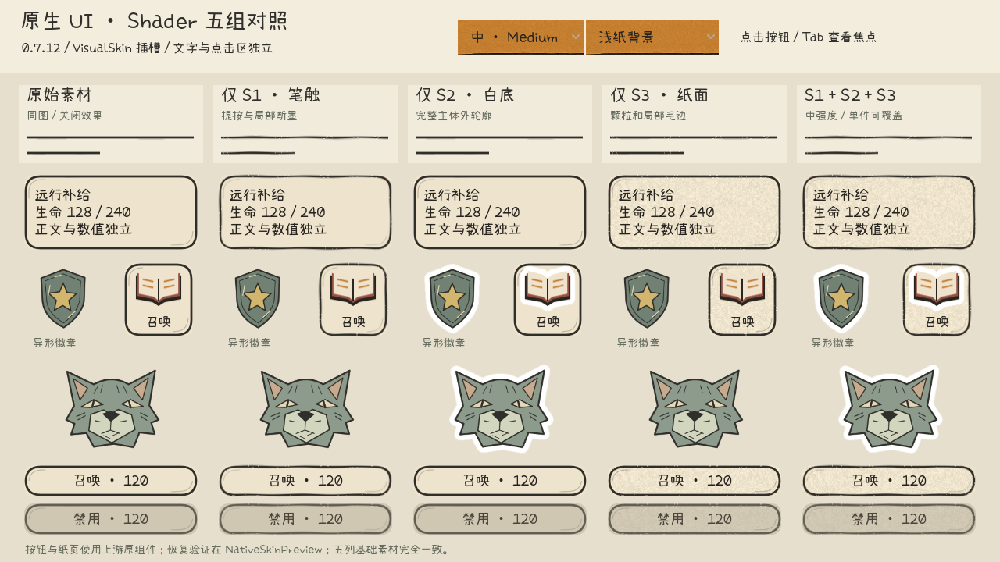

# 2026-10-15 获取与 Shader 构建

已从关联仓库 [Carloramia/SupremePoorGuy](https://github.com/Carloramia/SupremePoorGuy/tree/e97c6994152301127fd07b779e1dc32fc940b9c4/UI%E8%B7%B3%E8%BD%AC%E5%8E%9F%E5%9E%8B) 获取 UI跳转原型，固定提交 `e97c6994152301127fd07b779e1dc32fc940b9c4`，原型版本 **0.7.12**。

287 个上游文件完整保留，逐个校验 Git blob SHA-1。构建内容另放 `TA/`、新增测试和 `Tools/`；没有覆盖旧目录 `UI跳转原型/`、旧 Shader 材质库或宿主工程。详细来源和校验记录在 `.handoff/source-manifest.json`、`.handoff/source-verification.json`。

GitHub 交接整理时核对到 project.godot 省略两项与默认值相同的窗口 stretch 配置，当前文件保持原样；Godot 4.7.2 验证省略时仍为 disabled/keep。此项单列于 `.handoff/source-adaptations.json`，其余 286 个来源文件字节一致。上述原样获取和下文测试数字是此前验证阶段的记录。

## 打开和运行

用 Godot **4.7.2** 导入本目录 [project.godot](project.godot)。

| 入口 | 用途 |
| --- | --- |
| [TA/Scenes/ShaderComparison.tscn](TA/Scenes/ShaderComparison.tscn) · F6 | 同素材原始／S1／S2／S3／组合对照，轻中强和三种背景 |
| [TA/Scenes/NativeSkinPreview.tscn](TA/Scenes/NativeSkinPreview.tscn) · F6 | 在新版现有 TA 场景中应用／撤回材质，检查宽窄按钮、纸页、图标和头像 |
| [Scenes/GameDemo.tscn](Scenes/GameDemo.tscn) · F5 | 完整上游 UI 原型，保持原布局与默认外观，未批量启用新材质 |

从本目录运行 PowerShell：

```powershell
./Tools/Run-TAShaders.ps1
./Tools/Run-TAShaders.ps1 -NativePreview
./Tools/Run-TAShaders.ps1 -Tests
./Tools/Run-TAShaders.ps1 -Capture
```

引擎路径可传 `-GodotPath` 或设置 `GODOT_BIN`，工具也能找到当前工作区已有的 `.tools/godot`。Shader 场景没有业务模型或存档；验证工具将测试读写隔离在 `Tests/.runtime/`。

干净解压时 -Tests 先实际执行 Shader 检查生成其结果，再运行原隔离检查及上游回归，避免静态扫描将尚未生成的输出文件当作缺失资源。运行时结果不随源码交付。

NativeSkinPreview 沿用现有“应用测试预设／恢复当前外观”按钮。根节点 `Preview Preset` 默认中强度，可在编辑器指定自己的 UISkinPreset。调整材质参数后点击“应用测试预设”刷新。

- `1 / 2 / 3`：轻／中／强。
- `Q / W / E / R / T`：原始素材／仅 S1／仅 S2／仅 S3／组合。
- `B`：切换背景。对照页的“复杂地图”是测试用程序图案。

## 本轮交付

S1 提供基于可替换笔触素材的九宫格线框 Shader，控制粗细变化、轻微偏折、复笔强度和局部断墨；长短分割线使用同一材料。S2 根据整体 Alpha 剪影生成连续白底，封闭内孔填白，顶点留边不改变控件点击矩形。S3 将纸面／颜料颗粒和局部边缘磨损配套应用，只作用于底纸和墨线。

默认轻／中／强预设都使用原生 [UISkinPreset](Scripts/UI/UISkinPreset.gd)，可交给新版现有插槽；白底还需 [ShaderSkinBinding](TA/ShaderSkinBinding.gd) 准备剪影。完整参数、单组件覆盖和撤回方式见 [TA 接入说明](TA/README.md)。

真实渲染检查发现原插槽的普通 Node 会使部分生成装饰层脱离控件坐标。本轮在独立适配层下增加不参与容器布局的 Node2D 绘制锚点，正确继承原控件变换，同时避免九宫格最小尺寸扩大按钮。上游脚本和场景均未修改。新增层忽略鼠标，原生文字与输入仍由原控件负责。

参考图已按新版需求案核对；六张用户参考与需求文字副本保存在 `.handoff/references/`，仅作内部视觉核对，没有作为生产贴图使用。原型带背景、带烘焙阴影的概念图保持原样；独立测试头像使用另一张透明 SVG，不通过 Shader 猜测照片主体。

## 验证

**上游回归 1,789 项通过；Shader 无窗口检查 82 项、真实 GPU 检查 118 项通过，全部零失败。** 两种 Shader 检查存在重叠，不合计为独立用例。

覆盖召唤2.0、四阶阵面、组件契约、事件、任务、筛选、滚动、嵌套返回、地点预览及真实渲染的 A2 动效。旧测试中七符文／固定三只／固定61格的口径已由上游召唤2.0记录替代，本轮使用当前验证入口。

Shader 验证包含：

- 1120×680、1280×720、1920×1080 下，接入前后原有控件矩形、最小尺寸、字体、字号和文字一致。
- 宽窄按钮与纸页正确对齐；装饰层忽略输入，真实鼠标点击和禁用状态正确。
- 悬停、按下、禁用、键盘焦点与单件种子；局部预设不修改兄弟组件。
- 原样式、纸纹裁切、焦点和透明度恢复；多次应用／撤回稳定。
- 白底内孔、外边缘、原图画布边缘及无投影／光晕的像素检查。
- 静止帧逐字节相同；双分辨率、浅纸／深色／复杂背景和强度对照。

环境：Windows，Godot 4.7.2-stable，GL Compatibility，OpenGL 3.3，NVIDIA GeForce RTX 4070 SUPER。结构隔离检查通过，87 个 Godot 源文件、256 个资源引用；上游源文件零改动。

验证数据：[TA/VALIDATION.json](TA/VALIDATION.json)。14 张本轮截图在 [Tests/TA/screenshots](Tests/TA/screenshots)，与上游历史截图分开保存。



目标移动设备尚未做性能预算验证；最终美术强度仍可由负责人用正式透明素材评审。当前交付在独立测试场景接入，正式召唤、仓库等页面继续保留当前基线。
