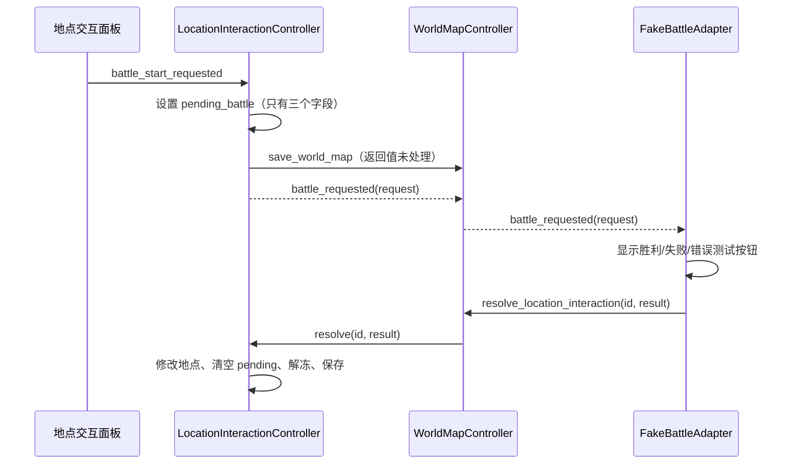
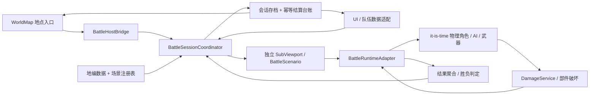
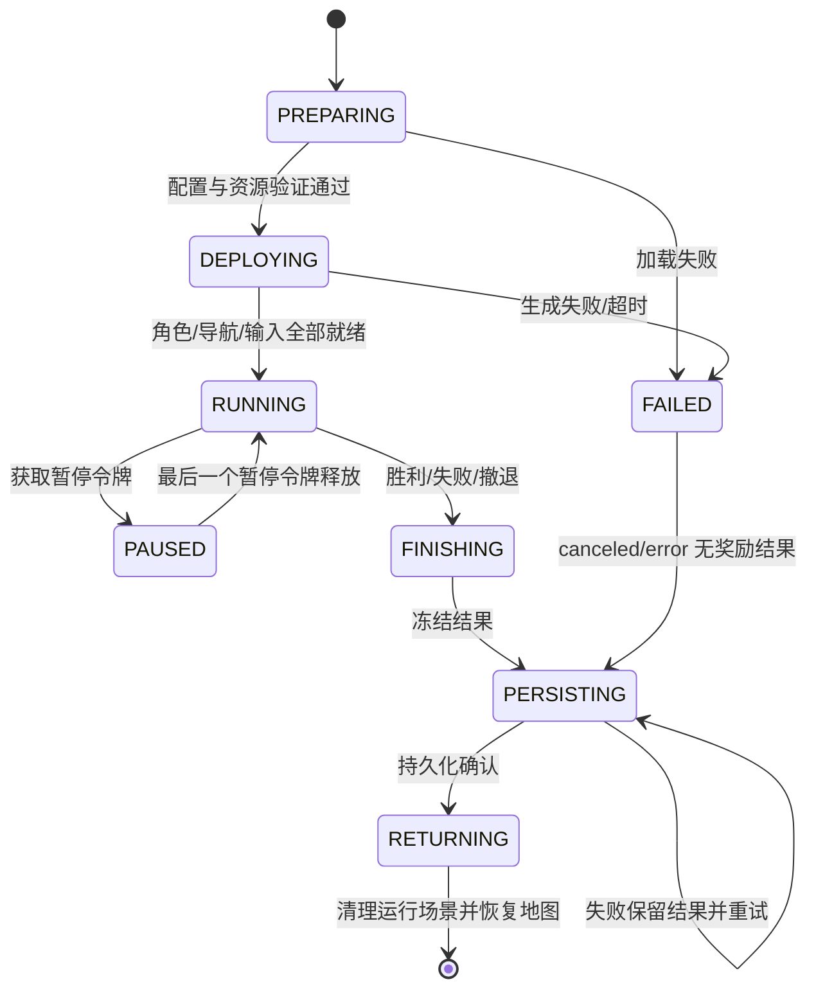

# 2.5D 场景与 it-is-time 实际战斗系统对接技术文档

审计日期：2026-10-15。接入对象已确认是关联 GitHub 仓库 `Carloramia/SupremePoorGuy` 中的 `it-is-time`。本交付完成代码盘点、边界整理和可执行的接入设计；**实际战斗尚未接入当前主场景**。文中标为“拟新增”的类、事件及协议均为实施规格，不能作为现有 API 调用。

上游依据固定为提交 [`e97c6994152301127fd07b779e1dc32fc940b9c4`](https://github.com/Carloramia/SupremePoorGuy/tree/e97c6994152301127fd07b779e1dc32fc940b9c4/it-is-time)。本地只检出了战斗脚本、场景、部分资源、文档和测试，以便审计；Assets 等资源并不完整。现有 UI Shader 独立工程仍为 `UI跳转原型_20261015`，未修改其已确认布局。

## 1. 交付导航与结论

| 文档 / 工具 | 用途 |
| --- | --- |
| [当前代码地图](battle_integration/CURRENT_CODE_MAP.md) | 各模块职责、真实接口、调用链、版本差异及缺口证据 |
| [请求、结果和单位契约](battle_integration/CONTRACTS.md) | 字段、映射、存档事务、失败恢复与接口伪代码 |
| [实施步骤与修改清单](battle_integration/IMPLEMENTATION_PLAN.md) | P0 问题、逐文件改动、里程碑、依赖与回退 |
| [验收与本次验证](battle_integration/ACCEPTANCE.md) | 当前测试证据、待实施用例、运行方式和性能采样 |
| [源码索引](battle_integration/SOURCE_INDEX.md) / [机器索引](battle_integration/SOURCE_INDEX.json) | 51 个关键文件、公开声明行号、SHA-256、上游链接和资源引用 |
| [请求 Schema](battle_integration/schemas/battle_request.schema.json) / [结果 Schema](battle_integration/schemas/battle_result.schema.json) | 拟定 v1 JSON 契约；附 [请求示例](battle_integration/examples/battle_request.json)、[结果示例](battle_integration/examples/battle_result.json) |

当前具备“地图冻结 → 进入独立 3D 世界 → 返回地图”的城镇基础设施，以及“物理角色 → 接触伤害 → 部件破坏 → 角色失能”的战斗基础设施。中间缺少统一的战斗会话：队伍快照、配置解析、部署、就绪屏障、输入权限、胜负判定、结果冻结、可靠结算及返回恢复。

首期建议交付一个有限遭遇战：固定战场、一个玩家角色、一个敌方 NPC、真实物理伤害、真实胜负、可靠返回。完成这一闭环后，再开放多单位、召唤 2.0、分身及战后持久部件损伤。

## 2. 当前运行链与目标运行链

当前大地图战斗入口：



当前城镇入口走 `scenario_requested` 和 `ScenarioOverlay`，与上述战斗入口独立。城镇退出无条件产生 `success=true`、`complete_location=false` 的访问结果。它不是战斗结算接口。

目标链中以下 `Battle*` 均拟新增：



原则：大地图只管理地点生命周期；场景只提供空间、相机和拾取；战斗系统计算伤害；会话协调器管理一场战斗及存档；UI 展示数据并提交操作意图。任何一层都不再用“跳过战斗”按钮发放正式奖励。

## 3. 工程合并与引擎基线

| 项目 | 当前配置 | 对接影响 |
| --- | --- | --- |
| 当前根工程 | Godot 4.7，GL Compatibility；F5 为 `ui_module/demo/UIWorldMapDemo.tscn` | 已验证基础地图、场景与旧版 UI；不能据此宣称战斗渲染通过 |
| it-is-time | Godot 4.7 / C# / Forward Plus 特性声明；Jolt；Windows 配置含 D3D12 | 保留其物理与渲染基线后实测；不可覆盖成宿主配置而略过回归 |
| C# 工程 | `Godot.NET.Sdk/4.7.2`；桌面 net8.0、Android net9.0 | 当前 Git tree 中 `.cs` 文件为 0；不等同于已证明所有构建目标不需要 .NET |
| 新版 UI | 独立 0.7.12 原型 + TA Shader 测试 | 当前宿主仍嵌入旧 0.5 原型；两个 UI 状态对象不能同时成为队伍权威 |

建议正式集成以完整 `it-is-time` 工程为物理基线，将宿主的 `world_map/`、`scenario_2_5d/`、`integration/`、必要 UI 模块以命名目录合入。这样保留其大量 `res://Scripts/...`、`Scenes/...`、`Resources/...`、`Shaders/...` 引用。主入口随后改为统一地图入口，原 `TestLevel.tscn` 保留为战斗回归场景。**这是建议的合并方向，本次没有执行工程搬迁。**

若最终必须以当前根工程为主，则先移入战斗所需的完整依赖闭包，再逐项合并 Autoload、InputMap、物理引擎及渲染设置。资源路径重定位必须覆盖 GDScript 的 preload/load/extends、tscn/tres 的外部资源和动态构造路径，随后清理目标工程导入缓存并重新导入 UID。仅复制角色脚本或仅复制 TestLevel 都不能形成可运行的集成。

全局配置清单：

1. `DamageService` 为伤害硬依赖，名字和根路径必须满足现有脚本查找。缺失时武器路径会得到零伤害。
2. 审核 `WorkshopUIController` 与 `RuntimeConsole`：前者为工坊功能，后者参与输入遮挡及诊断；首期可保留，但不能未经核对删除其场景资源。
3. InputMap 按大小写保留 `Left/Right/Up/Down/Space/Shift/QPressed/MouseLeft/BPressed/EPressed` 等实际动作，并检查数字键、Ctrl、控制台键。宿主相机中键拖动与战斗光标各自只保留一个监听者。
4. `ItIsTime.csproj` 中存在 `.godot` 缓存内容引用，应在正式跨机器构建前整理。依赖完整性以重新导入与导出结果为准。
5. 资源索引的“上游已跟踪但未检出”是审计缓存状态，不是仓库缺资源。另有一条可疑直接资源引用：`Generate_HornedBeast.tscn` 引用的 `Assets/2DResources/HornedBeast/Separated/Attachments/01_horn_fan.png` 不在当前 Git tree 中；启用该原型前必须核对大小写、替代资源或补交资源。

## 4. 场景组装与生命周期

建议新建以下运行场景；禁止直接把带 DemoUI 的 `Scenario25DDemo` 或带测试摄像机的 `TestLevel` 整体嵌套上线。

```text
BattleScenario (ScenarioController 派生；拟新增)
├─ CameraController + Camera3D        固定斜俯视正交相机
├─ InteractionController              统一选择/地面指令入口
├─ OcclusionController                仅视觉遮挡
├─ TerrainRoot                        静态碰撞、场景地面标记
├─ NavigationRoot / NavigationRegion3D 实际导航网格
├─ SpawnRoot                          稳定 spawn_id / 阵营 / 空间信息
└─ BattleRuntimeRoot                  本场会话所有权边界
   ├─ UnitsRoot                       物理角色及其多部件
   ├─ FxRoot                          伤害数字、冲击波等
   ├─ DropsRoot                       地面装备与临时物品
   ├─ RuntimeAdapter                  注册、死亡观察、结果汇总
   └─ InputBridge                     玩家控制器、光标、UI 输入门禁
```

独立 `SubViewport` 设 `own_world_3d=true`、正确的尺寸与输入转发。World3D 隔离物理空间；SceneTree 的 group、Autoload 和 `Input` 单例仍共享，必须显式加上战斗上下文。跨场景组查询至少校验 `actor.get_world_3d() == context.world_3d`，且只接受本会话注册角色；引用已释放节点时立即注销。

拟新增会话状态：



`battle_id` 在请求持久化前生成，所有异步回调带此 ID。失效会话的加载回调、迟到死亡事件、双击返回不得改变当前会话。每个状态定义超时和允许操作；加载超时是 `error`，不能当作敌人死亡或玩家胜利。

## 5. 部署、生成与导航屏障

`SpawnPoint3D` 当前只是带 ID/metadata 的 Marker；地编导出的部署点是普通 `Marker3D`，尚未注册 `scenario_spawn`。对接时统一转换为会话 SpawnRegistry：稳定 ID、位置、朝向、阵营、队位组及占用半径，不能直接按全树 group 顺序分配。

部署顺序必须明确：

1. 验证场景、敌方波次、队伍快照和原型注册表。冻结队伍修订号，禁止进入期间继续移动单位到仓库。
2. 实例化角色并在入树前设置 `faction_id`、角色 ID、局部 Transform、生成器配置和 `generate_on_ready=false`。生成器配置先 `duplicate(true)`，避免修改共享 `.tres` 影响后续角色。
3. 在正确父节点下连接生成事件，再入树；由适配层显式调用现有 `generate_creature()`，检查布尔返回及最终部件状态。若沿用 `generate_on_ready=true`，必须在 `add_child` 前订阅 `creature_generation_finished`，不能依赖 root `_ready` 当作生成完成。
4. 每个角色都确认有效 DamageController、存活头/躯干、部件 RID、武器持有者与阵营、唯一 `actor_id`。等待生成后的 deferred 完整性检查，设置属性时同时处理 `max_hp/current_hp` 与 `is_broken`。
5. 等 NavigationServer 同步完成，确认该 World3D 导航 map 有 region、迭代号有效、出生点可投射且路径可达。`NavigationRoot` 空节点不是导航。
6. 等待物理落地与碰撞稳定，才开放 AI 攻击和玩家输入；落地策略按原型包围盒计算，不统一从 Y=5 抛下。位置使用 XZ 平面、Y 为高度，与地编契约一致。

胜利条件必须同时满足：会话处于 RUNNING、敌方注册/生成数与计划一致、没有待生成波次、没有尚在生成的敌人、所有敌人被确认失能。空注册表、资源加载失败和导航未就绪都不能触发胜利。

`NavigationNPCSpawner3D` 是带定时补员的测试/运行工具，不是玩家队伍部署器。有限战斗关闭自动补员；新增 WaveScheduler 记录 planned/spawning/active/completed，明确下一波触发条件。

## 6. 物理战斗、UI 数值与身份

实际伤害链：物理接触冲量 → `SampleWeapon3D.apply_contact_damage` → DamageService 规则/护甲 → `PhysicalBodyPart3D.apply_damage` → 部件破坏 → CharacterDamageController 图连通性检查 → 角色失能。

UI 的 `hp/attack/armor/speed/interval/part_hp` 是召唤原型产物。它们尚未映射到实际部件、武器和行动资源。不能在物理伤害外再按 UI attack 扣一次血；也不能直接令 `hp = 所有部件血量之和` 并假设符合死亡规则。

详细字段映射见 [CONTRACTS.md](battle_integration/CONTRACTS.md)。接入时单独建立带版本的 StatProfileResolver：部件 HP/护甲、武器伤害参数、移动参数、攻击冷却及能力资源。缺少规则的原型在 PREPARING 报错。当前默认 DamageRules 中普通接触与主动挥击的阈值、倍率和上限属于现有平衡参数，不能自动视为召唤攻击数值的公式。

角色永久身份为 `monster_id`；一场战斗实例身份为 `actor_id`；部件身份为稳定 `part_key`。NodePath、instance_id 和 RID 只做临时关联。增殖分身有独立 actor_id 并指向本体，默认不进入永久仓库；生成器蓝图需冻结布局或版本，否则同一随机种子未必得到同一部件集合。

首期建议战后仅保存胜负、奖励与审计统计，部件损伤只在本场有效；这一策略须在 M0 明确确定。若需要永久伤势，则补充部件持久协议、已断肢体再生成规则、恢复规则和旧存档迁移，再启用 `persist_parts`。不能让 UI 卡片 hp 临时覆盖成剩余血量而丢失原始最大生命。

## 7. 2.5D 相机、视觉与战斗输入

场景相机固定斜俯视正交，可沿用 ScenarioCameraController。实际角色根节点通常不跟着各 RigidBody 部件移动，应通过 `get_combat_anchor()` 或 PlayerController 的 `get_control_anchor()` 定位动态躯干。

现有 `set_focus_target()` 只设置引用，`focus_on_target()` 才执行一次位置跳转；没有自动追随。若要持续跟随，拟新增 CameraFollowBridge 在每帧计算 anchor XZ，调用受边界约束的目标位置更新，且规定手动拖动时如何暂时退出追随。切换控制角色后更新 anchor 与遮挡目标。

不要把 ScenarioCameraController 直接赋给 PlayerController.camera_rig：后者初始化会写 `follow_target`，前者没有该属性。首期把这个导出引用留空，使用 `controlled_character_changed` 驱动相机桥；关闭 it-is-time 原 DragCamera3D，确保每个视口只有一个 current Camera3D。

物理角色包含真实多部件和关节，不能整体套用单 Quad 的 BillboardVisual3D，不能把整个物理根节点转向相机。纸片美术只在纯视觉子节点适配。大小变化通过生成器 `overall_scale` 或对应原型配置在生成前完成；GeneratedCreature 明确拒绝根节点/生成器 Transform 的非单位缩放。

输入桥必须同时控制事件与轮询：

| 情况 | 地图 | 场景相机 | 角色/AI | 结算 UI |
| --- | --- | --- | --- | --- |
| 准备/部署 | 冻结 | 可选择关闭 | 关闭 | 仅加载/错误提示 |
| RUNNING 且视口有焦点 | 冻结 | 开放 | 根据手操/自动模式开放 | 不阻挡的 HUD |
| 打开阻挡 UI / 控制台 | 冻结 | 关闭 | 执行暂停策略；禁止全局 Input 穿透 | 开放 |
| 结算/保存失败 | 冻结 | 关闭或只读 | 冻结 | 重试/查看结果 |
| 持久化成功后 | 恢复 | 释放 | 运行场景释放 | 返回地图 |

`set_camera_input_enabled(false)` 只禁用相机。InteractionController 没有总体输入开关；TerrainCursor 和 PlayerController 仍可能读 Input 单例。拟新增 `BattleInputGate`，统一处理焦点、鼠标是否位于子视口、模态窗、状态和暂停令牌。地面点击只走一条链：Scenario 的射线 → 验证地面 → 指令桥 → NPC.move_to_position，或选择 TerrainCursor 为唯一来源并禁用前者。按选定控制模式实施，不能两条同时生效。

ScenarioInteractionController 只对 `scenario_ground` 命中派发地面事件；TerrainCursor 当前接受 StaticBody3D 的范围更宽，会把建筑识别成地面。统一射线策略时保留实体遮挡，不能通过排除建筑让玩家隔墙下令。

## 8. 暂停、伤害展示与跨世界对象

现有大地图 paused 是地图逻辑状态，不等于 SceneTree.paused。战斗应使用局部暂停令牌；只改 process_mode 无法完整暂停物理刚体。记录 AI/行动/Timer 的原状态、刚体 freeze/速度/睡眠状态、控制角色，再冻结本场子树与物理体。恢复时按快照还原，不恢复已死亡角色，不把被断肢体重新激活。

`disable_character_controls()` 是死亡/失能动作，PlayerController 的 `set_character_control_enabled(false)` 会 detach；都不能直接作为可逆暂停接口。相机及 PlayerController 使用 ALWAYS 处理模式，需额外门禁。暂停期间取消当前挥击还是保留进度须统一规定，并验证恢复时没有残留伤害窗口。

已定位的跨 World3D 高风险点：

| 位置 | 当前行为 | 拟改动 |
| --- | --- | --- |
| PhysicalBodyParts._spawn_damage_number | 加到 current_scene/root | 注入本场 FxRoot，验证同 World3D |
| InventoryController3D 丢弃装备 | 重挂 current_scene/root | 注入 DropsRoot，明确战后回收策略 |
| CreatureActionController3D 冲击波 | 使用 current_scene | 注入 FxRoot，销毁归本场会话 |
| StompShockwave3D | 全树角色组遍历，没有 World3D 过滤 | 按 BattleContext 注册表 + World3D 限定目标 |
| PlayerControlContext / TerrainCursor / Arc | 存在全局组选择 | 用上下文解析控制器、目标和指示器 |

NPCStateMachine 的主要敌友判定已检查同 World3D；这不能替代其他路径的隔离，也不能据此断言所有 AI 子类都已隔离。伤害数字是展示；它不应驱动第二次伤害或胜负结算。

遮挡系统只负责视觉淡化。遮挡层、攻击视线、导航障碍与物理碰撞分别定义；现有 Ground/Building、角色和武器的掩码需要制作实际矩阵，验证后再迁移。不得直接将“视觉淡化”解释为能穿墙攻击。

## 9. 结算、存档与恢复

当前 `resolve_location_interaction()` 返回 true 仅表示匹配了当前交互；内部保存的布尔返回未检查。当前 UI 存档与地图存档各自使用单文件替换，无法组成跨文件事务。

拟新增统一 SessionStore：把地图状态、队伍/货币、战斗 pending、结果台账放进同一个版本化会话快照。结果按 `battle_id + result_id` 幂等应用。结算只允许由该服务发放奖励，UI 的 `claim_once("battle_"+location,20)` 测试路径退出正式运行。已有存档先备份，再迁移为统一快照；老地点记录不能推断为新战斗已结算。

顺序为：停止伤害与新生成 → 等延迟完整性事件处理 → 冻结结果 → 验证 ID/修订号/奖励规则 → 纯数据投影并保存 → 收到持久化确认 → 更新 UI 和地图 → 释放本场 → 解冻地图。保存失败保留不可变结果与冻结场景，允许重试，不先关闭窗口，也不重新算奖励。

若必须保留多个存档文件，则实现事务日志/outbox：写 PREPARED（含完整结果与目标投影）、幂等写各存储、写 COMMITTED，启动时重放未提交事务。仅添加一个 `save()` 调用不能解决断电窗口。具体步骤与兼容 result 适配见 [CONTRACTS.md](battle_integration/CONTRACTS.md)。

当前物理系统没有可用的整场断点存档。首期只恢复“已准备的请求”与“已冻结的结果”，处理中断战斗需按明确政策重新开局或取消；不能宣称 seed 可重演 Jolt 的全过程，也不能在崩溃恢复时隐式判胜。

## 10. 实施顺序与完成标准

按 [实施计划](battle_integration/IMPLEMENTATION_PLAN.md) 的 M0–M5 顺序完成：先工程与资源、再一个真实角色闭环、再跨世界和输入隔离、再可靠结算、最后新版 UI 与召唤规则。每个阶段保留旧 Demo 作为回归入口，用功能开关切换真实 BattleHostBridge；同一入口不能同时连接 FakeBattleAdapter。

本次交付不改变已确认的 UI 布局，不把 TA Shader 变成战斗逻辑依赖。TA 材质继续作用于 Control 的独立材质实例；受击、高亮、低血等展示应由 HUD 适配器订阅战斗事件后更新，材质不持有角色生命与奖励权威。

完成条件以 [验收矩阵](battle_integration/ACCEPTANCE.md) 为准：真实武器造成真实部件伤害，胜负来自实际失能和波次状态，所有对象留在同一战斗 World3D，结算可幂等恢复，返回后地图与队伍一致，原有城镇和 Shader 独立测试仍能运行。
