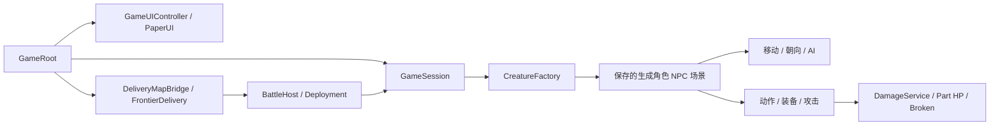

# 系统总览

正式游戏的宿主是 [GameRoot.gd](../../Scripts/Application/GameRoot.gd)。它连接 UI、会话存档、地图与战斗模块；各系统应使用同一 `GameRoot.session`，不另建会话写入当前玩家的数据。

## 分系统导航

| 系统 | 入口与修改位置 |
|---|---|
| [应用、存档与生物实例](Application/README.md) | GameRoot、GameSession、CreatureFactory、头像 |
| [生成、部件与可挂载模组](Creatures/README.md) | Generator、PartSceneRule、手动布局、密度、Joint |
| [运动、转向与 AI](MovementAI/README.md) | 移动继承链、步态预设、寻路、索敌与动作接管 |
| [攻击、伤害与断裂](Combat/README.md) | 各物种攻击、武器命中、全局伤害、阵营与 Broken |
| [攻击与受击音效](Audio/README.md) | 原型 WAV、触发事件、空间播放、暂停与混战限幅 |
| [装备、材料与工坊](EquipmentWorkshop/README.md) | 物品栏、多持握点、武器类别、材料和网格构建 |
| [地图、界面与部署](WorldMapUI/README.md) | 地图 JSON、敌方编队、原型适配、暂停与设置 |
| [任务、符文与召唤](QuestsRunes/README.md) | 实际新手待办、独立任务框架、符文效果入口 |
| [符文与奇物首轮接入](Summoning/README.md) | 当前9+8目录、独立测试场景、真实效果、事件发奖适配器和限制 |
| [输入、光标与摄像机](InputCamera/README.md) | 正式输入门控、测试 Controller、DragCamera |
| [日志、测试与导出](DebugExport/README.md) | 控制台、性能模式、可视化、包体自检 |

## 配置由谁负责

| 需要改变的行为 | 首先修改 |
|---|---|
| 一种素材的外观与连接孔 | 源 PNG、模型清单、对应的物理 Part 场景 |
| 生物默认构造与部位映射 | Generator 的参数、`part_scene_rules`、独立默认预设 |
| 手工摆好的角色姿态 | 角色捕获的 `manual_layout` 与部件内部快照 |
| 移动速度与步态 | 该控制器实际挂载的 Movement `.tres`，注意继承覆盖 |
| 攻击动作幅度 | 接收器的攻击数据；AI 的选择距离单独在 Behavior/Attack 选项中配置 |
| 冲量转伤害 | 全局 `DamageService` 使用的 `DefaultDamageRules.tres` |
| 战场部署与敌人 | DeliveryBattleSettings、EnemyRosters、地图配置 |
| 召唤池 | `CreatureFactory.SUMMON_POOL`，不能仅添加一个角色场景 |
| 文案 | 本地化 JSON；物种 ID、PartKey、节点路径不作为译文修改 |

多数生成角色通过标签发现部件，不要求部件是角色的直接子节点。使用 `PlayerControlContext.character_of()` 和角色查询接口，避免把 `get_parent()` 当作固定角色根节点。一个 Part 可能同时带多个标签，生成类型和物理标签也不完全等价。
